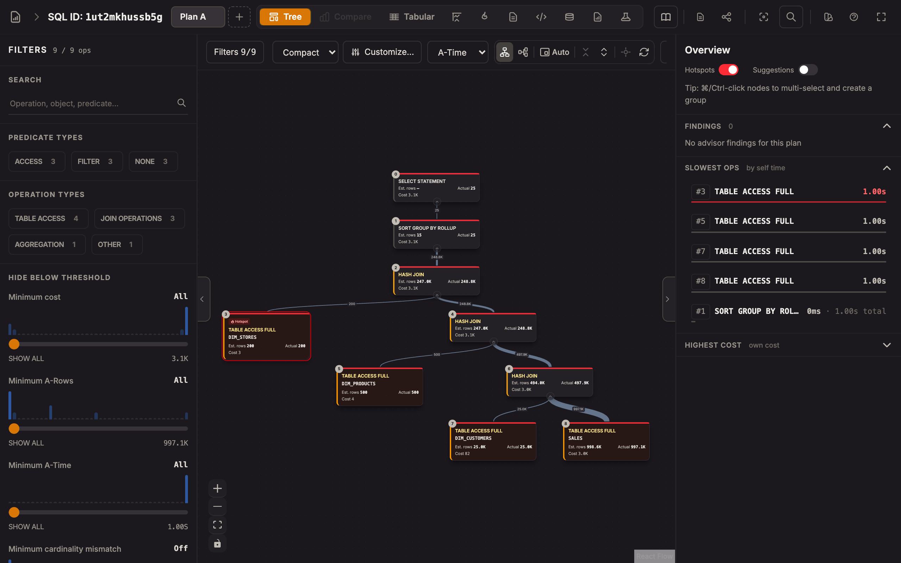
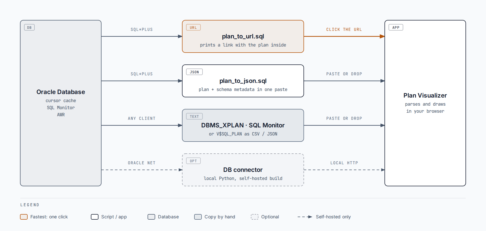
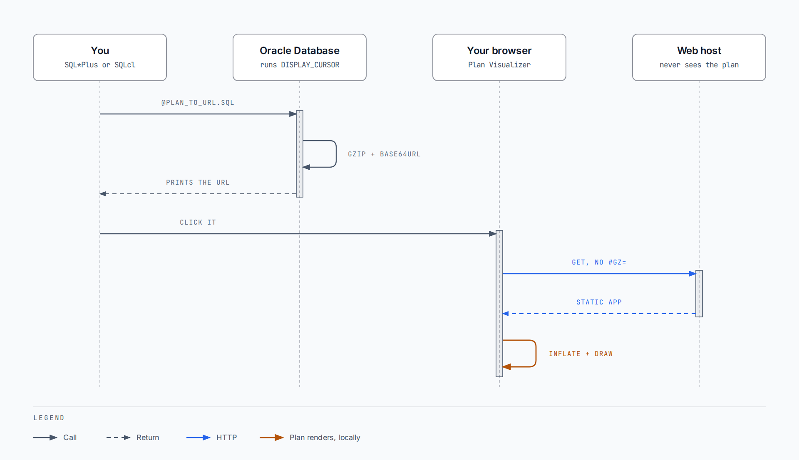
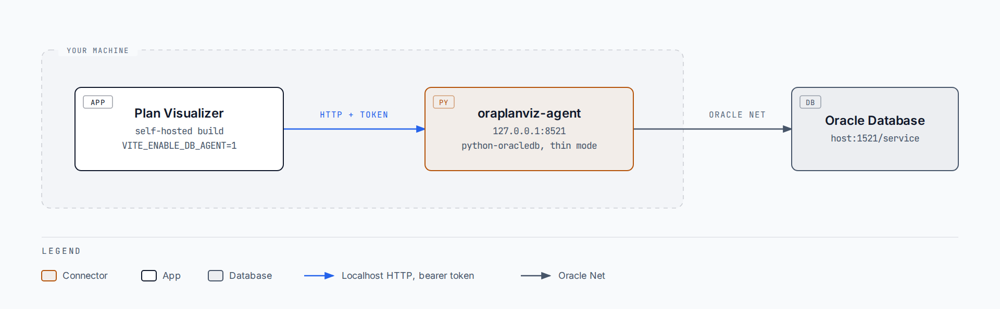
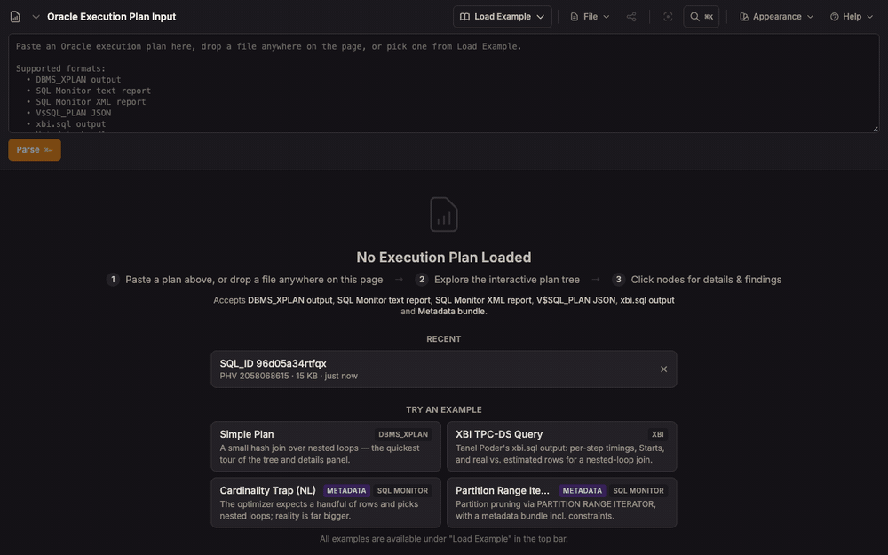
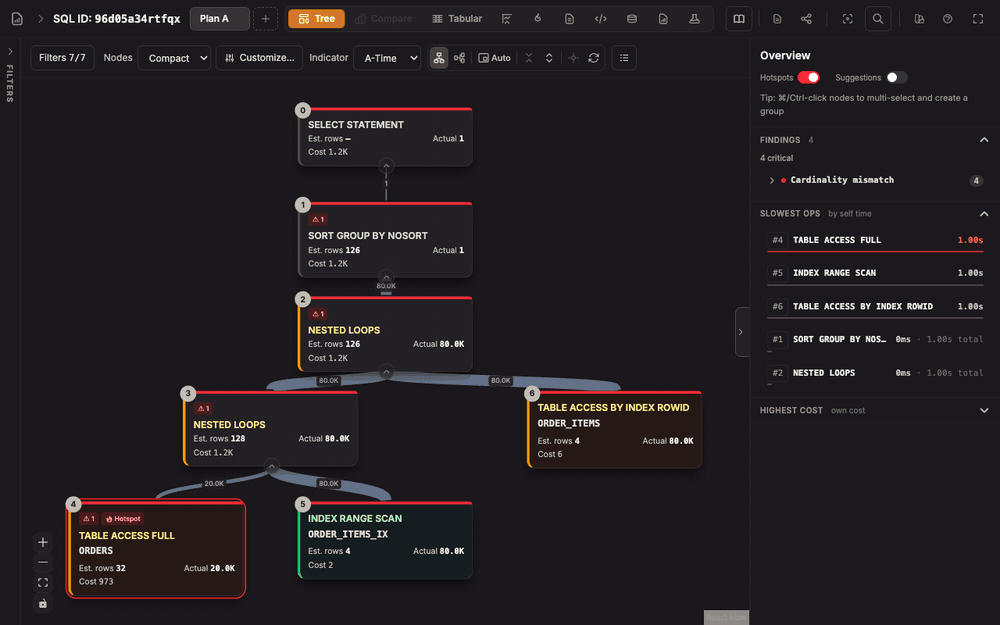
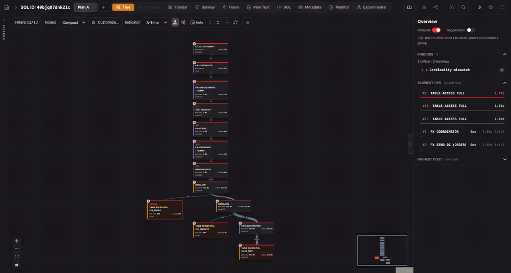
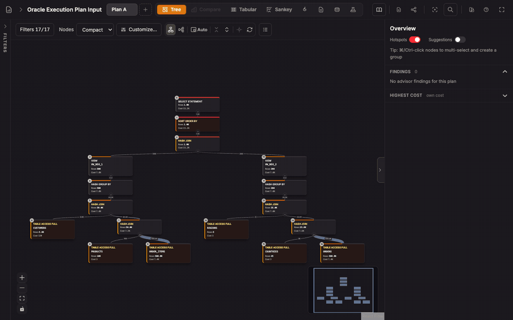

# Oracle Execution Plan Visualizer

Paste an Oracle execution plan and get an interactive tree you can search, filter, annotate and compare. It reads DBMS_XPLAN output (including `ALLSTATS` and `ADVANCED`), SQL Monitor reports (text, XML or the ACTIVE HTML page), V$SQL_PLAN as JSON or CSV, and Tanel Poder's xbi.sql output.

It runs in your browser, with no server. Use the [hosted copy](https://davidbudac.github.io/ora-explain-plan-viz/) (installable, works offline once visited) or download `oraplanviz-vX.Y.Z.html` from the [latest release](https://github.com/davidbudac/ora-explain-plan-viz/releases): one file, opened from disk, no internet needed.

[](https://davidbudac.github.io/ora-explain-plan-viz/?example=21)

[Documentation](https://davidbudac.github.io/ora-explain-plan-viz/welcome/docs.html) · [Getting a plan out of Oracle](docs/input-formats.md) · [SQL scripts](scripts/README.md) · No plan at hand? Use **Load Example** in the app.

## Getting a plan in

<picture>
  <source media="(prefers-color-scheme: dark)" srcset="docs/diagrams/ways-in-dark.png">
  
</picture>

### One click from SQL*Plus: `plan_to_url.sql`

<picture>
  <source media="(prefers-color-scheme: dark)" srcset="docs/diagrams/plan-to-url-dark.png">
  
</picture>

[`scripts/plan_to_url.sql`](scripts/plan_to_url.sql) compresses the plan for a `sql_id` inside the database and prints a link that opens the app with the plan loaded. On 19c:

```text
SQL> @plan_to_url.sql 6967f7q140w9t
Building a share URL for sql_id 6967f7q140w9t ...

https://davidbudac.github.io/ora-explain-plan-viz/#gz=H4sIAAAAAAACA81da2_bNhf-nl9BeAWc9H…

sql_id: 6967f7q140w9t   child: 0   source: CURSOR
plan lines: 243
raw bytes: 26850   gzip bytes: 3333   ratio: 8.1x
URL length: 4498 chars
```

```sql
@plan_to_url.sql <sql_id>                         -- cursor cache, child 0, ALLSTATS LAST
@plan_to_url.sql <sql_id> 1                       -- child cursor 1
@plan_to_url.sql <sql_id> "" MONITOR [exec_id]    -- SQL Monitor report (Tuning Pack license)
@plan_to_url.sql <sql_id> "" AWR [plan_hash]      -- from AWR after the cursor aged out (Diagnostics Pack license)
```

`QUIET` prints the URL alone: `sqlplus -s user@db @plan_to_url.sql <sql_id> QUIET | pbcopy`. The script is read-only; other sessions' cursors need read access to `V$SQL_PLAN` (e.g. `SELECT_CATALOG_ROLE`). Self-hosting? Change `base_url` at the top.

The plan rides in the URL fragment (`#gz=…`), which browsers never send to the server, so the web host never sees it. The link does carry the SQL text: share it as you would the plan.

### Plan and metadata in one paste: `plan_to_json.sql`

[`scripts/plan_to_json.sql`](scripts/plan_to_json.sql) takes the same arguments and prints the plan plus the [schema metadata](#schema-metadata) of the objects it touches as one JSON block. Paste the terminal output into the app, or save it and drop the file. Its `CURSOR` source reads `ADVANCED ALLSTATS LAST`, so outline, peeked binds and hint report come along. `NOMETA` skips the metadata.

### Paste or drop

Paste any supported format into the input box and press `Cmd+Enter` (`Ctrl+Enter`), drop a file anywhere on the window, or press `Cmd+O` (`Ctrl+O`). [docs/input-formats.md](docs/input-formats.md) has the query for each format.

### Optional: connect to the database

<picture>
  <source media="(prefers-color-scheme: dark)" srcset="docs/diagrams/db-connector-dark.png">
  
</picture>

[`oraplanviz-db-connector`](https://github.com/davidbudac/oraplanviz-db-connector) is a small Python program on your machine that lets the app list recent statements and load plans straight from the database. It uses python-oracledb in thin mode (no Oracle Client), listens on `127.0.0.1` only, requires a bearer token and keeps credentials in memory. The DB Connect panel is not in the hosted copy or the release file, so build the app with it:

1. `VITE_ENABLE_DB_AGENT=1 npm run dev`, or `docker compose --profile agent up --build` (served on port 8081).
2. `pipx install git+https://github.com/davidbudac/oraplanviz-db-connector.git` (Python 3.9+).
3. Run `oraplanviz-agent` (add `--allow-origin http://localhost:8081` for the Docker build) and copy the token it prints.
4. Open **DB Connect** in the app, paste the token, connect, and pick a statement. Leave **Attach DB metadata** checked to load the schema metadata as well.

Details: the connector's [Quick start](https://github.com/davidbudac/oraplanviz-db-connector#quick-start) and the [site docs](https://davidbudac.github.io/ora-explain-plan-viz/welcome/docs.html#db-connector).

## Schema metadata

A plan doesn't say whether stats were stale, which columns have histograms or which indexes exist. A metadata bundle does: table, column and index statistics, partitioning, constraints, and any baselines, SQL profiles, patches or directives on the statement. Attach one and:

- plan nodes get badges for stale stats, missing stats, and estimate errors on columns without a histogram
- the details panel shows the object and column statistics next to the predicates
- the Metadata tab browses the tables, indexes and columns, and pops out into its own window
- the advisor rules that need schema data (unused index, stats issues, function on an indexed column) switch on

Get a bundle from `plan_to_json.sql`, from the DB connector, or from [`scripts/gather_plan_metadata.sql`](scripts/README.md#gather_plan_metadatasql). The app's *Gather script* button fills in the SQL ID for you. The *Cardinality Trap (NL)* and *Partition Range Iterator* examples come with a bundle attached.

## What you can do with a plan

### Explore

The app detects the format, draws the tree and shows estimates, actuals, predicates and metadata for any node. Arrow keys move through the tree.



### Find the problem

Advisor findings (cardinality mismatches, spills, nested loops over many rows and more) and the slowest operations come first. Click one to jump to its node.



### Compare two plans

Load a before/after pair, view them side by side, then open the Compare tab for per-operation differences. `Cmd+K` opens the command palette.



### Annotate and share

Add notes and colour highlights to nodes. Save them as JSON, or put the plan and your notes into a share link.



### Hand off to an agent

*File → Agent handoff* builds one Markdown prompt for Claude Code, Codex, ChatGPT or another agent: the plan, the app's analysis, your question, how to read Oracle's numbers, and the SQL to fetch whatever is missing. The [`oracle-plan-analysis`](skills/oracle-plan-analysis/SKILL.md) skill teaches the agent the workflow (`npx skills add davidbudac/ora-explain-plan-viz`, or download it from the dialog).

### Also

| | |
|---|---|
| **Views**: Tabular, Sankey, Plan Text, SQL, and an Experimental tab (timeline with ASH wait classes, E-Rows vs A-Rows scatter, wasted-work waterfall) | **Filters** by operation, predicate, cost/rows/time range and cardinality mismatch |
| **SQL Plan Baseline / SQL Patch** scripts (DBMS_SPM / DBMS_SQLDIAG), with patch hints taken from the plan's outline | **Hints**: the Hint Report and outline decisions drawn on the operations they affect |
| **Client report**: plan, notes and findings as one self-contained HTML file, or printed to PDF | **Appearance**: light and dark themes, 5 palettes, 8 node colour schemes, three densities, focus mode (`Z`) |

## Run it yourself

```bash
git clone https://github.com/davidbudac/ora-explain-plan-viz.git
cd ora-explain-plan-viz && npm install && npm run dev      # http://localhost:5173
```

`docker compose up --build` serves it on port 8080 (`PORT` changes it, `APP_BASE_PATH=/sub/path/` serves it under a sub-path). `npm run build:single` writes the single-file build to `dist-single/index.html`.

Parsers, plan types, analysis helpers and the advisor live in [`packages/ora-plan-core`](packages/ora-plan-core/README.md) (unpublished, no React or DOM), so tools such as [modern-tkprof](https://github.com/davidbudac/modern-tkprof) can reuse them.

## License

[MIT](LICENSE)
